# 03 — PEMETAAN DATA KANONIKAL & SKEMA BASIS DATA (DATABASE BLUEPRINT)
## Portal Web Resmi Balai Monitor Spektrum Frekuensi Radio Kelas I Pekanbaru

---

## 1. Inventarisasi 22 Berkas Modular Canonical JSON

Seluruh data konten default portal web saat ini tersimpan dalam 22 berkas modular JSON ber-skema Ajv ketat yang berlokasi di `frontend/src/lib/data/`. Berkas-berkas ini terbagi ke dalam 8 domain:

```
frontend/src/lib/data/
├── contacts/
│   └── office.json                     # Alamat, telepon, jam operasional, koordinat peta
├── coverage/
│   ├── districts.json                  # Data 12 Kabupaten/Kota di Riau
│   ├── spectrum-applications.json      # Sektor pemanfaatan spektrum frekuensi
│   └── summary.json                    # Ringkasan stasiun monitoring tetap & bergerak
├── institution/
│   ├── functions.json                  # 9 Tugas Pokok UPT Permenkominfo 17/2021
│   ├── legal-bases.json                # Landasan hukum pembentukan Balmon
│   ├── organization.json               # Pejabat & struktur organisasi balai
│   └── profile.json                    # Visi, misi, dan nilai budaya BerAKHLAK
├── performance/
│   ├── distribution-2025.json          # Distribusi izin spektrum tahun berjalan
│   ├── metrics-2025.json               # Capaian IKU & ketersediaan SMFR
│   └── reports.json                    # Daftar dokumen laporan kinerja (LAKIP)
├── publications/
│   ├── articles.json                   # Siaran pers & berita kegiatan
│   ├── education.json                  # Topik edukasi publik seputar frekuensi
│   └── featured-video.json             # Video profil YouTube resmi balai
├── public_information/
│   ├── documents.json                  # Regulasi, standar pelayanan, dan dokumen publik
│   └── ppid.json                       # Profil PPID, hak pemohon, & SOP KIP
├── services/
│   ├── catalog.json                    # 4 Layanan perizinan utama balai
│   ├── complaint.json                  # SOP & kanal pengaduan gangguan sinyal
│   ├── faqs.json                       # Tanya jawab umum seputar layanan
│   └── portals.json                    # Tautan portal eksternal (SIMS SDPPI, SP4N)
└── site_content/
    ├── hero.json                       # Konten headline & CTA beranda
    └── homepage.json                   # Konfigurasi menu cepat & susunan beranda
```

---

## 2. Klasifikasi Dinamisasi Data (Static to Dynamic Matrix)

Untuk mengarahkan pembangunan backend secara efektif dan terukur, ke-22 berkas diklasifikasikan ke dalam 4 strategi data:

```
Total: 22 Berkas Modular Canonical JSON
├── 1. DYNAMIC_MANAGED   (6 Berkas) -> Wajib dibuatkan Tabel DB & CRUD Admin CMS
├── 2. DYNAMIC_READ_ONLY  (7 Berkas) -> Dibuatkan Tabel DB, disajikan via Public API
├── 3. HYBRID             (5 Berkas) -> Sebagian field di DB, sebagian statis di kode
└── 4. KEEP_STATIC        (4 Berkas) -> Tetap di repositori Git, tidak perlu tabel DB
```

### Tabel Matriks Klasifikasi:

| No | Domain | Nama Berkas | Klasifikasi | Kebutuhan Tabel Database | Kebutuhan Seeding di TASK 6 |
| :---: | :--- | :--- | :---: | :--- | :---: |
| 1 | `publications` | `articles.json` | **`DYNAMIC_MANAGED`** | Tabel `articles` (judul, slug, content array, cover, kategori, tanggal). | **YA (Wajib)** |
| 2 | `publications` | `education.json` | **`DYNAMIC_MANAGED`** | Tabel `education_topics` (slug, title, summary, content array, icon). | **YA (Wajib)** |
| 3 | `public_information` | `documents.json` | **`DYNAMIC_MANAGED`** | Tabel `public_documents` (title, category, year, file_url, number). | **YA (Wajib)** |
| 4 | `services` | `catalog.json` | **`DYNAMIC_MANAGED`** | Tabel `services_catalog` (title, slug, summary, requirements, steps). | **YA (Wajib)** |
| 5 | `services` | `portals.json` | **`DYNAMIC_MANAGED`** | Tabel `service_portals` (title, category, url, source_url). | **YA (Wajib)** |
| 6 | `services` | `faqs.json` | **`DYNAMIC_MANAGED`** | Tabel `service_faqs` (question, answer, order_index). | **YA (Wajib)** |
| 7 | `coverage` | `districts.json` | **`DYNAMIC_READ_ONLY`**| Tabel `districts` (nama kab/kota, stasiun, koordinat, status). | **YA (Wajib)** |
| 8 | `coverage` | `spectrum-applications.json` | **`DYNAMIC_READ_ONLY`**| Tabel `spectrum_applications` (sektor, icon, deskripsi, image_url). | **YA (Wajib)** |
| 9 | `coverage` | `summary.json` | **`DYNAMIC_READ_ONLY`**| Tabel `coverage_summary` (total distrik, stasiun tetap, mobile DF). | **YA (Wajib)** |
| 10 | `performance` | `metrics-2025.json` | **`DYNAMIC_READ_ONLY`**| Tabel `performance_metrics` (tahun, capaian IKU, ketersediaan SMFR). | **YA (Wajib)** |
| 11 | `performance` | `distribution-2025.json`| **`DYNAMIC_READ_ONLY`**| Tabel `performance_distribution` (label izin, jumlah unit, warna hex). | **YA (Wajib)** |
| 12 | `performance` | `reports.json` | **`DYNAMIC_READ_ONLY`**| Tabel `performance_reports` (metadata laporan LAKIP tahunan). | **YA (Wajib)** |
| 13 | `public_information` | `ppid.json` | **`DYNAMIC_READ_ONLY`**| Tabel `ppid_profiles` (SOP KIP, kontak meja PPID, dasar hukum). | **YA (Wajib)** |
| 14 | `contacts` | `office.json` | **`HYBRID`** | Tabel `office_settings` (hotline, WA, jam layanan, koordinat peta). | **YA (Parsial)** |
| 15 | `institution` | `organization.json` | **`HYBRID`** | Tabel `organization_members` (pimpinan, jabatan, foto, urutan). | **YA (Wajib)** |
| 16 | `services` | `complaint.json` | **`HYBRID`** | Tabel `complaint_settings` (kanal telepon aduan, email, kontak posko). | **YA (Parsial)** |
| 17 | `site_content` | `hero.json` | **`HYBRID`** | Tabel `hero_banners` (headline kampanye, subtitle, teks tombol). | **YA (Parsial)** |
| 18 | `publications` | `featured-video.json` | **`HYBRID`** | Tabel `featured_videos` (ID video YouTube, judul, status aktif). | **YA (Wajib)** |
| 19 | `institution` | `profile.json` | **`KEEP_STATIC`** | Tetap di kode statis (Visi, Misi, Budaya Kerja BerAKHLAK statuter). | **TIDAK** |
| 20 | `institution` | `functions.json` | **`KEEP_STATIC`** | Tetap di kode statis (9 Tugas Pokok berdasarkan Permenkominfo 17/2021). | **TIDAK** |
| 21 | `institution` | `legal-bases.json` | **`KEEP_STATIC`** | Tetap di kode statis (Landasan hukum pembentukan UPT Balmon). | **TIDAK** |
| 22 | `site_content` | `homepage.json` | **`KEEP_STATIC`** | Tetap di kode statis (Konfigurasi menu cepat & arsitektur seksi). | **TIDAK** |

---

## 3. Rancangan Basis Data Relasional (Entity-Relationship Diagram)

Berikut adalah rancangan diagram relasi entitas untuk basis data backend:

```mermaid
erDiagram
    ARTICLES {
        uuid id PK
        string slug UK
        string title
        text excerpt
        jsonb content "array of paragraph strings"
        date published_at "YYYY-MM-DD"
        string category
        jsonb source "{ label, publisher, url }"
        jsonb image "{ type, url, alt, width, height }"
        jsonb video "{ id, eyebrow, title, embedUrl }"
        boolean featured
        boolean published
        timestamp created_at
        timestamp updated_at
    }

    EDUCATION_TOPICS {
        uuid id PK
        string slug UK
        string title
        text summary
        jsonb content "array of paragraph strings"
        string icon
        jsonb source "{ label, publisher, url }"
        jsonb image "{ type, url, alt }"
        string video_id
        timestamp created_at
    }

    PUBLIC_DOCUMENTS {
        uuid id PK
        string document_id UK "e.g. reg-permenkominfo-17-2021"
        string title
        string category "regulasi | layanan | laporan"
        string year "4 digit string: 2024"
        string number "Nomor regulasi resmi"
        text description
        jsonb source "{ label, publisher, url }"
        string file_url "URL unduhan PDF"
        timestamp created_at
    }

    SERVICES_CATALOG {
        uuid id PK
        string slug UK
        string title
        text summary
        text description
        string icon
        boolean featured
        integer home_order
        boolean active
        jsonb requirements "array of string"
        jsonb steps "array of string"
        string official_url
    }

    SERVICE_PORTALS {
        uuid id PK
        string portal_id UK
        string title
        string category "panduan | perizinan | pembayaran | pengaduan | nelayan"
        string url
        string source_url
    }

    SERVICE_FAQS {
        uuid id PK
        string question
        text answer
        integer sort_order
    }

    DISTRICTS {
        uuid id PK
        string district_id UK "e.g. pekanbaru, kampar"
        string name
        string capital
        string station_type "fixed | mobile | planned"
        string status "aktif | terjadwal | pengembangan"
        numeric latitude
        numeric longitude
        text notes
    }

    PERFORMANCE_RECORDS {
        uuid id PK
        integer year UK "e.g. 2025"
        string eyebrow
        jsonb title "{ first, second }"
        text description
        jsonb metrics "array of { label, value, target, achievementPercent }"
        jsonb chart "{ eyebrow, title, year, months, averageAvailability, ... }"
        jsonb distribution "{ total, items: [{ label, count, color }] }"
    }

    OFFICE_SETTINGS {
        uuid id PK
        string office_name
        string parent_agency
        jsonb address "{ street, city, postalCode, directions }"
        jsonb phone "{ display, uri }"
        jsonb whatsapp "{ display, uri }"
        jsonb email "{ display, uri }"
        jsonb service_hours "{ days, time, note }"
        jsonb location "{ latitude, longitude, targetUrl, embedUrl }"
        jsonb socials "{ instagram: { label, url } }"
    }
```



---

## 4. Definisi Skema DDL SQL (PostgreSQL & SQLite 3)

Skema di bawah ini kompatibel dengan PostgreSQL 16 (menggunakan kolom `JSONB`) dan SQLite 3 (menggunakan kolom `TEXT` yang divalidasi dengan `json_valid()`):

```sql
-- 1. TABEL ARTIKEL BERITA (PUBLICATIONS DOMAIN)
CREATE TABLE IF NOT EXISTS articles (
    id VARCHAR(64) PRIMARY KEY,
    slug VARCHAR(255) NOT NULL UNIQUE,
    title VARCHAR(500) NOT NULL,
    excerpt TEXT NOT NULL,
    content JSONB NOT NULL,                   -- Array of string paragraphs: ["paragraf 1", "paragraf 2"]
    published_at DATE NOT NULL,              -- YYYY-MM-DD
    category VARCHAR(100) NOT NULL,          -- e.g. "Spektrum", "Layanan", "Kegiatan"
    source JSONB NOT NULL,                   -- {"label": "...", "publisher": "...", "url": "..."}
    image JSONB,                             -- {"type": "url", "url": "...", "alt": "...", "width": 1280, "height": 720}
    video JSONB,                             -- {"id": "...", "title": "...", "embedUrl": "..."}
    featured BOOLEAN NOT NULL DEFAULT FALSE,
    published BOOLEAN NOT NULL DEFAULT TRUE,
    created_at TIMESTAMP WITH TIME ZONE DEFAULT CURRENT_TIMESTAMP,
    updated_at TIMESTAMP WITH TIME ZONE DEFAULT CURRENT_TIMESTAMP
);
CREATE INDEX IF NOT EXISTS idx_articles_slug ON articles(slug);
CREATE INDEX IF NOT EXISTS idx_articles_featured ON articles(featured);
CREATE INDEX IF NOT EXISTS idx_articles_published_at ON articles(published_at DESC);

-- 2. TABEL TOPIK EDUKASI
CREATE TABLE IF NOT EXISTS education_topics (
    id VARCHAR(64) PRIMARY KEY,
    slug VARCHAR(255) NOT NULL UNIQUE,
    title VARCHAR(500) NOT NULL,
    summary TEXT NOT NULL,
    content JSONB NOT NULL,                   -- Array of string paragraphs
    icon VARCHAR(100) NOT NULL,
    source JSONB NOT NULL,
    image JSONB,
    video_id VARCHAR(100),
    created_at TIMESTAMP WITH TIME ZONE DEFAULT CURRENT_TIMESTAMP
);
CREATE INDEX IF NOT EXISTS idx_education_slug ON education_topics(slug);

-- 3. TABEL DOKUMEN PUBLIK & REGULASI
CREATE TABLE IF NOT EXISTS public_documents (
    id VARCHAR(64) PRIMARY KEY,
    title VARCHAR(500) NOT NULL,
    category VARCHAR(50) NOT NULL,           -- 'regulasi' | 'layanan' | 'laporan'
    year VARCHAR(10) NOT NULL,               -- Wajib string 4 digit: '2024'
    number VARCHAR(255),                     -- e.g. "Permenkominfo No. 17 Tahun 2021"
    description TEXT NOT NULL,
    source JSONB NOT NULL,
    file_url VARCHAR(1000),
    created_at TIMESTAMP WITH TIME ZONE DEFAULT CURRENT_TIMESTAMP
);
CREATE INDEX IF NOT EXISTS idx_documents_category ON public_documents(category);
CREATE INDEX IF NOT EXISTS idx_documents_year ON public_documents(year);

-- 4. TABEL KATALOG LAYANAN PUBLIK
CREATE TABLE IF NOT EXISTS services_catalog (
    id VARCHAR(64) PRIMARY KEY,
    slug VARCHAR(255) NOT NULL UNIQUE,
    title VARCHAR(255) NOT NULL,
    summary TEXT NOT NULL,
    description TEXT NOT NULL,
    icon VARCHAR(100) NOT NULL,
    featured BOOLEAN NOT NULL DEFAULT FALSE,
    home_order INTEGER NOT NULL DEFAULT 99,
    active BOOLEAN NOT NULL DEFAULT TRUE,
    requirements JSONB,                      -- Array of string
    steps JSONB,                             -- Array of string
    official_url VARCHAR(1000)
);
CREATE INDEX IF NOT EXISTS idx_services_slug ON services_catalog(slug);
CREATE INDEX IF NOT EXISTS idx_services_home_order ON services_catalog(home_order);

-- 5. TABEL PORTAL LAYANAN EKSTERNAL
CREATE TABLE IF NOT EXISTS service_portals (
    id VARCHAR(64) PRIMARY KEY,
    title VARCHAR(255) NOT NULL,
    category VARCHAR(50) NOT NULL,           -- 'panduan' | 'perizinan' | 'pembayaran' | 'pengaduan' | 'nelayan'
    url VARCHAR(1000) NOT NULL,
    source_url VARCHAR(1000) NOT NULL
);

-- 6. TABEL TANYA JAWAB (FAQ)
CREATE TABLE IF NOT EXISTS service_faqs (
    id SERIAL PRIMARY KEY,
    question TEXT NOT NULL,
    answer TEXT NOT NULL,
    sort_order INTEGER NOT NULL DEFAULT 0
);

-- 7. TABEL DISTRIK KABUPATEN / KOTA RIAU
CREATE TABLE IF NOT EXISTS districts (
    id VARCHAR(64) PRIMARY KEY,
    name VARCHAR(100) NOT NULL,
    capital VARCHAR(100) NOT NULL,
    station_type VARCHAR(50) NOT NULL,       -- 'fixed' | 'mobile' | 'planned'
    status VARCHAR(50) NOT NULL,             -- 'aktif' | 'terjadwal' | 'pengembangan'
    latitude NUMERIC(9,6) NOT NULL,
    longitude NUMERIC(9,6) NOT NULL,
    notes TEXT
);

-- 8. TABEL METRIK & DISTRIBUSI KINERJA TAHUNAN
CREATE TABLE IF NOT EXISTS performance_records (
    id SERIAL PRIMARY KEY,
    year INTEGER NOT NULL UNIQUE,
    eyebrow VARCHAR(100) NOT NULL,
    title JSONB NOT NULL,                    -- {"first": "Kinerja", "second": "2025"}
    description TEXT NOT NULL,
    metrics JSONB NOT NULL,                  -- [{"label": "...", "value": "...", "target": "...", "achievementPercent": 104.2}]
    chart JSONB,                             -- Objek serialisasi grafik ketersediaan SMFR
    distribution JSONB NOT NULL,             -- {"total": 1250, "items": [{"label": "...", "count": 500, "color": "..."}]}
    created_at TIMESTAMP WITH TIME ZONE DEFAULT CURRENT_TIMESTAMP
);

-- 9. TABEL PENGATURAN KONTAK KANTOR & JAM LAYANAN
CREATE TABLE IF NOT EXISTS office_settings (
    id INTEGER PRIMARY KEY DEFAULT 1,
    office_name VARCHAR(255) NOT NULL,
    parent_agency VARCHAR(255) NOT NULL,
    address JSONB NOT NULL,
    phone JSONB NOT NULL,
    whatsapp JSONB NOT NULL,
    email JSONB NOT NULL,
    service_hours JSONB NOT NULL,
    location JSONB NOT NULL,
    socials JSONB NOT NULL,
    updated_at TIMESTAMP WITH TIME ZONE DEFAULT CURRENT_TIMESTAMP,
    CONSTRAINT single_office_row CHECK (id = 1)
);
```

---

## 5. Strategi Data Seeding Otomatis dari Berkas Kanonikal

Backend TASK 6 wajib menyediakan skrip inisialisasi basis data (*seeding script*) yang membaca langsung 22 berkas canonical JSON di `frontend/src/lib/data/` dan memindahkannya ke tabel database dengan prinsip **Idempotensi (dapat dijalankan berulang tanpa duplikasi)**.

### Contoh Logika Seeder Python (FastAPI / SQLAlchemy):

```python
# backend/scripts/seed_database.py
import json
from pathlib import Path
from sqlalchemy.orm import Session
from app.db.session import SessionLocal
from app.models import Article, PublicDocument, ServiceItem, District, OfficeSetting

DATA_DIR = Path(__file__).resolve().parents[2] / "frontend" / "src" / "lib" / "data"

def seed_articles(db: Session):
    with open(DATA_DIR / "publications" / "articles.json", "r", encoding="utf-8") as f:
        data = json.load(f)
        for item in data.get("articles", []):
            existing = db.query(Article).filter(Article.slug == item["slug"]).first()
            if not existing:
                db.add(Article(
                    id=item["id"],
                    slug=item["slug"],
                    title=item["title"],
                    excerpt=item["excerpt"],
                    content=item["content"],
                    published_at=item["publishedAt"],
                    category=item["category"],
                    source=item["source"],
                    image=item.get("image"),
                    video=item.get("video"),
                    featured=item.get("featured", False),
                    published=item.get("published", True),
                ))
    db.commit()

def seed_documents(db: Session):
    with open(DATA_DIR / "public_information" / "documents.json", "r", encoding="utf-8") as f:
        data = json.load(f)
        for item in data.get("documents", []):
            existing = db.query(PublicDocument).filter(PublicDocument.id == item["id"]).first()
            if not existing:
                db.add(PublicDocument(
                    id=item["id"],
                    title=item["title"],
                    category=item["category"],
                    year=str(item["year"]),
                    number=item.get("number"),
                    description=item["description"],
                    source=item["source"],
                    file_url=item.get("fileUrl")
                ))
    db.commit()

def main():
    db = SessionLocal()
    try:
        print("Memulai proses seeding data canonical ke database...")
        seed_articles(db)
        seed_documents(db)
        # Lanjutkan untuk domain services, coverage, performance, contacts...
        print("Seeding data selesai dengan sukses 100%!")
    finally:
        db.close()

if __name__ == "__main__":
    main()
```

