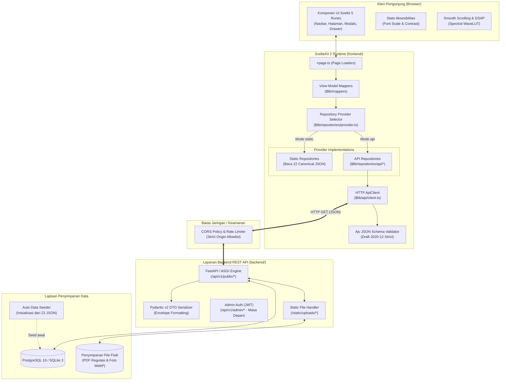

# DOKUMENTASI GLOBAL SISTEM & PANDUAN PENGEMBANGAN BACKEND
## Portal Web Resmi Balai Monitor Spektrum Frekuensi Radio Kelas I Pekanbaru
**Ditjen Infrastruktur Digital / Ditjen SDPPI — Kementerian Komunikasi dan Digital Republik Indonesia**

---

## 1. Ringkasan Eksekutif (Executive Summary)

Repositori ini memuat sistem aplikasi web portal resmi **Balai Monitor Spektrum Frekuensi Radio Kelas I Pekanbaru (Balmon Pekanbaru)**. Tahap pembangunan antarmuka pengguna (*Frontend / FE*) telah selesai secara komprehensif, mencakup 11 route aplikasi, 42 komponen Svelte 5, sistem desain editorial Ditjen SDPPI/Komdigi, kepatuhan aksesibilitas WCAG 2.2 AA, dan arsitektur data berbasis **Repository Provider Pattern** dengan 22 berkas canonical JSON modular.

Dokumentasi global di dalam folder `dokumentasi-global/` ini disusun khusus sebagai **panduan utama, Single Source of Truth (SSOT), dan cetak biru teknis bagi pengembang atau AI agent untuk membangun lapisan Backend (BE)** dan mengintegrasikannya secara mulus dengan Frontend yang telah berjalan.

---

## 2. Struktur Navigasi Dokumentasi Global

Dokumentasi terbagi ke dalam 4 modul utama yang saling melengkapi:

| Berkas Dokumentasi | Fokus & Cakupan Utama | Target Pembaca |
| :--- | :--- | :--- |
| [**01_DOKUMENTASI_FRONTEND.md**](file:///d:/KERJA/magang%20hub/batch2/Balaimonitor/balmon-pekanbaru/dokumentasi-global/01_DOKUMENTASI_FRONTEND.md) | **Arsitektur Lengkap Frontend**: Stack teknologi (SvelteKit 2 + Svelte 5 Runes), struktur direktori, lifecycle aplikasi, 11 rute navigasi, sistem desain, aksesibilitas, dan mekanisme kerja **Repository Provider Pattern** (`static` vs `api`). | Frontend Dev, Fullstack Dev, QA |
| [**02_SPESIFIKASI_API_INTEGRASI.md**](file:///d:/KERJA/magang%20hub/batch2/Balaimonitor/balmon-pekanbaru/dokumentasi-global/02_SPESIFIKASI_API_INTEGRASI.md) | **Spesifikasi Kontrak REST API**: Konvensi amplop response (`{ success, data, meta }`), error envelope baku, inventaris lengkap **24 unique HTTP endpoints** & **25 repository reader methods**, parameter, DTO respons, validasi Ajv 2020-12, dan contoh payload nyata. | Backend Dev, API Architect, Integration QA |
| [**03_DATA_CANONICAL_DAN_DATABASE_MAPPING.md**](file:///d:/KERJA/magang%20hub/batch2/Balaimonitor/balmon-pekanbaru/dokumentasi-global/03_DATA_CANONICAL_DAN_DATABASE_MAPPING.md) | **Model Data & Skema Database**: Inventarisasi 22 berkas canonical JSON modular, klasifikasi data dinamis (6 Managed, 7 Read-Only, 5 Hybrid, 4 Static), Diagram ERD relasional, DDL PostgreSQL/SQLite, dan strategi data seeding otomatis dari JSON. | Database Administrator, Backend Dev |
| [**04_PANDUAN_PENGEMBANGAN_BACKEND.md**](file:///d:/KERJA/magang%20hub/batch2/Balaimonitor/balmon-pekanbaru/dokumentasi-global/04_PANDUAN_PENGEMBANGAN_BACKEND.md) | **Panduan Implementasi Backend (FastAPI)**: Standar struktur folder `backend/`, konfigurasi CORS aman, pemisahan variabel rahasia (`.env`), handling file uploads/PDF, tahapan milestone (M1–M5), dan cara menguji integrasi FE-BE end-to-end. | Backend Dev, DevOps, Security Auditor |

---

## 3. Topologi Sistem & Alur Integrasi End-to-End

Berikut adalah arsitektur aliran data sistem dari browser pengunjung hingga database backend:



---

## 4. Ringkasan Singkat Stack Teknologi

### Frontend:
- **Framework Core**: SvelteKit 2 (`@sveltejs/kit` 2.70.3) & Svelte 5 (`svelte` 5.57.1) dengan sintaks modern **Runes** (`$state`, `$derived`, `$props`).
- **Styling**: Tailwind CSS v4 (`@tailwindcss/vite` 4.3.3) berpadu dengan tema institusional Komdigi.
- **Komponen & Ikon**: Bits UI (headless accessible primitives) & Lucide Svelte.
- **Peta Interaktif**: D3-geo & TopoJSON Provinsi Riau.
- **Animasi & Interaksi**: GSAP 3.15.0 (*Spectral Wave LUT Engine*) & Lenis 1.3.26 (*smooth scrolling*).
- **Validasi Kontrak**: Ajv 8.17.1 (JSON Schema Draft 2020-12).

### Backend (Akan Dibangun):
- **Framework Rekomendasi**: Python 3.12+ dengan **FastAPI** (ASGI asynchronous).
- **Serialisasi Data**: Pydantic v2 (menjamin tipe data selaras 100% dengan OpenAPI 3.1 dan Ajv).
- **Database Engine**: 
  - *Development / Local*: SQLite 3 (WAL Mode) untuk kemudahan development cepat tanpa setup DB server.
  - *Staging / Production*: PostgreSQL 16 dengan kolom `JSONB` native.
- **ORM / Query Builder**: SQLAlchemy 2.0 (Async) atau SQLModel.
- **Manajemen Migrasi**: Alembic.

---

## 5. Panduan Cepat Menjalankan Sistem

### 5.1. Menjalankan Frontend
```powershell
# Masuk ke direktori frontend
Set-Location -LiteralPath 'frontend'

# Jalankan validasi skema data awal
node scripts/data/validate.js

# Jalankan server pengembangan frontend
pnpm run dev
# Server aktif di: http://localhost:5173
```

### 5.2. Mengaktifkan Mode Integrasi API pada Frontend
Frontend secara default menggunakan mode data lokal `static`. Untuk mengarahkan domain tertentu ke backend REST API, atur variabel lingkungan pada `frontend/.env`:

```env
# Aktifkan seluruh domain ke API backend
BALMON_DATA_SOURCE_DEFAULT=api
BALMON_API_BASE_URL=http://localhost:8000/api/v1/public

# Atau aktifkan per domain secara modular (Hybrid Mode):
BALMON_PUBLICATIONS_SOURCE=api
BALMON_SERVICES_SOURCE=api
BALMON_CONTACTS_SOURCE=api
```

---

## 6. Standar Rekayasa & Prinsip Kerja (Engineering Principles)

1. **SOLID, DRY, KISS, dan YAGNI**:
   Membangun fitur seminimal mungkin yang menyelesaikan masalah secara tepat tanpa over-engineering atau abstraksi prematur.
2. **Kontrak API adalah Hukum (Contract First)**:
   Backend wajib mengikuti spesifikasi DTO dan amplop response di [02_SPESIFIKASI_API_INTEGRASI.md](file:///d:/KERJA/magang%20hub/batch2/Balaimonitor/balmon-pekanbaru/dokumentasi-global/02_SPESIFIKASI_API_INTEGRASI.md). Dilarang mengubah nama properti atau format data tanpa rekonsiliasi ke skema Ajv frontend.
3. **Pemisahan Secrets**:
   Kredensial database, JWT secret, dan password server backend **dilarang keras** diletakkan di `frontend/.env` atau menggunakan awalan `BALMON_` / `VITE_`.
4. **Verifikasi Empiris**:
   Setiap progres integrasi wajib dibuktikan melalui test suite otomatis:
   `node scripts/data/test-provider-switching.js` dan `pnpm exec vitest run`.

